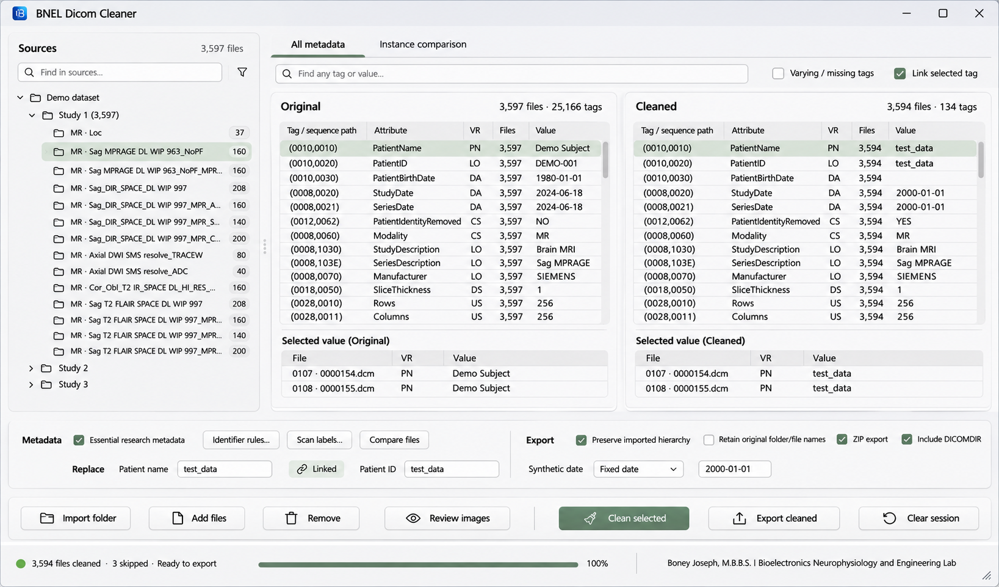

# BNEL Dicom Cleaner - Approved UI/UX Implementation Brief for Codex

**Revision:** 2.0 | **Date:** 2026-11-03 | **Status:** Implement the owner-approved direction; do not propose a different design.

**Target:** A compact, elegant, professional Windows desktop application with precise symmetry, quiet light surfaces, restrained sage accents, and a subtle macOS-inspired sense of spacing and finish. The application remains a native-framed Swing application. This is not a web dashboard, an oversized touch interface, or a purple/blue AI-product theme.

**Stack recorded in the supplied brief:** Java 21, Swing, FlatLaf 3.7. Verify these against the repository before implementation. This revision is based on the supplied brief, screenshots, and the owner's subsequent decisions; it does not claim that the current application source has been inspected or tested.

## 0. Paste this instruction to Codex first

> Implement the attached BNEL Dicom Cleaner UI brief and match the attached approved main-window mockup. Read the current source, READ-ME.md, GuiTest, and EngineTest first. Preserve the cleaning/export engine, safety rules, existing features, keyboard shortcuts, component names, and packaging. The only intended behavioral fixes are in UI navigation, scrolling, resizing, and presentation, as specified here. Put all main workflow buttons at the bottom; use a neutral light palette with restrained sage accents; preserve draggable panes; restore the exact author/lab credit at the bottom right. Treat symmetry as a measurable acceptance requirement. Implement the layout and its final visual tokens together, rather than delivering an intermediate blue-themed or top-toolbar version. Reuse existing actions and data models. Verify the actual result with tests and Windows screenshots before calling it complete. Do not modify protected engine code to solve a layout problem. If the required Windows environment is unavailable, identify that verification gap explicitly.

## 1. Authority and reference handling

The accompanying image is the approved visual reference:



**Reference file:** `BNEL-Dicom-Cleaner-Approved-Main-Mockup.png` (1637 x 961 pixels). Its role is to establish composition, visual weight, bottom-button placement, and footer arrangement. It is not a bitmap to place behind the real interface.

Apply this order of authority:

1. Existing data-integrity, privacy, file-disposal, and export safety behavior must remain intact.
2. The owner's explicit requirements and the measurable rules in this revision govern the UI.
3. The approved image governs appearance where this brief leaves a visual detail open.
4. The earlier brief is historical context only wherever it conflicts with this revision.

**Important corrections to the reference material:**

- Black rectangles on the original application screenshots were added manually after capture. They are not application widgets. Do not recreate them, add automatic black overlays, or infer a requirement to hide metadata behind rectangles. The actual pixel-blackout feature is separate and must remain functional.
- Mockup DICOM values, tag labels, file counts, dates, and rows are illustrative. Do not hardcode them, reproduce generation errors, or treat them as cleaning-policy requirements. Show the real model's values and counts.
- The resize grip drawn in the approved image is conditional, not mandatory. See section 7.
- Equal-width comparison panes are the default arrangement, not a restriction on the user's ability to resize them.
- Use macOS-inspired restraint and finish, not a claim of macOS 27 API support or a recreation of another operating system's title bar.

### Decisions that are already settled

| Topic | Required decision |
| --- | --- |
| Workflow commands | Bottom of the window, never a new top command toolbar. |
| Color | Neutral whites/grays with low-saturation sage; no conspicuous blue, purple, cyan, or multicolor theme. |
| Symmetry | Shared dimensions, aligned baselines, balanced default panes, consistent gaps; verified with measurements. |
| Author credit | Always present at the lower right of the main window; not moved into About. |
| Pane resizing | Real draggable splitters; preserve manual adjustments. |
| Window resizing | Native edge/corner resizing first; add a fallback grip only when native corner resizing is unavailable. |
| Review navigation | Single-click selection of individual `.dcm` leaves must display the corresponding file. |
| Tree scrolling | Smooth and responsive; no rebuilding the tree or snapping back during manual browsing. |
| Implementation scope | UI refactor and specified UI bug fixes, not a rewrite of the engine or framework. |

## 2. Preserve functionality and establish a baseline

Before editing, locate the actual entry points for the main window, review viewer, theme, source tree, comparison tables, actions, and tests. Inspect the repository rather than inventing class names or architecture from screenshots.

### Protected boundaries

Retain the existing behavior of `Cleaner`, `Policy`, `IdentifierPolicy`, `DicomIO`, `PixelSafety`, `ResidualGuard`, `FileDisposal`, `NativeRecycle`, and the data logic in `MetadataCompare`, `MetadataDifferences`, and `MetadataUnion`. Verify their actual locations. Do not change their algorithms, policies, or public contracts as part of this work.

Preserve UID handling, date/identity replacement, staged-output invalidation, metadata retention/removal, pixel processing, DICOMDIR eligibility, ZIP/folder export, report handling, original-file disposal, and all confirmations. Do not silently alter defaults, infer new de-identification rules, or weaken export gating.

UI listener wiring, presentation models, background task orchestration, and viewport behavior may be corrected where necessary for the explicitly requested navigation fixes. Keep those changes isolated and covered by tests. If a fix truly requires protected-domain changes, report the specific dependency and leave that change unimplemented pending approval; continue independent UI work.

### Baseline and release constraints

- Read every documented feature in `READ-ME.md`. Create a parity checklist before moving controls.
- Run the current tests first and record pre-existing failures separately. The original brief reports 430 EngineTest assertions; verify the actual baseline, preserve the entire existing suite unchanged, and do not reduce assertions to match that historical number.
- Preserve existing `setName()` identifiers used by GuiTest. Update structural lookup code only when necessary; retain behavioral assertions and add regression coverage.
- Preserve shortcuts, including M, Space, Left/Right, Page Up/Down, and Ctrl+wheel, with their existing focus-sensitive meanings. Do not intercept typing in text fields.
- Reuse existing `Action` objects or listeners and their enablement/confirmation logic. Moving a button must not duplicate its handler or create a second execution path.
- Keep Swing, the pinned FlatLaf version, and the native Windows title bar. Do not add a new UI framework or runtime dependency for this redesign.
- Preserve the existing release route: application JAR/resources change; launcher/runtime are reused through the repository's `private_repackage.py` process. Verify its actual filename and instructions rather than inventing a replacement build flow.
- Use synthetic/non-identifying fixtures for screenshots and tests. Do not add real DICOM files, patient identifiers, or original paths to commits or diagnostic logs.

## 3. Shared visual system

Implement one central set of theme/layout tokens and shared component builders. Do not scatter slightly different colors, insets, font sizes, or preferred heights through individual windows.

All dimensions below are logical UI units at a nominal 100% reference scale, not hardcoded physical screen pixels. Apply the application's DPI strategy once; do not double-scale Swing coordinates or fonts. Measure actual font metrics.

### Color and geometry tokens

| Token | Value / target |
| --- | --- |
| Window background | `#F4F4F3` |
| Primary surface | `#FFFFFF` |
| Sidebar / quiet secondary surface | `#F7F7F6` |
| Table header / neutral hover | `#EFEFED` / `#F1F2F0` |
| Subtle separator / control border | `#E3E4E1` / `#C8CCC7` |
| Primary / secondary text | `#202420` / `#596159` |
| Disabled text | `#8A9089`, with a distinct disabled treatment |
| Primary sage fill | `#5C7564` |
| Primary hover / pressed | `#526A5A` / `#465D4F` |
| Text on enabled primary fill | `#FFFFFF` |
| Selected-row background / text | `#E1E8E1` / `#202420` |
| Focus indicator | `#526A5A`, visible 2-unit ring or equivalent |
| Warning text / quiet background | `#805D24` / `#F7F1E7` |
| Destructive text / quiet background | `#9A4038` / `#FAEFED` |
| Spacing scale | 4, 8, 12, 16, 24 |
| Outer content inset | 12 on all sides |
| Standard inter-section gap | 12; internal related-control gap 8 |
| Control radius | 6; major surface radius 8 |
| Standard input/button height | 32 |
| Main bottom-command button height | 36 for every button in that bar |
| Icon size | 16; 32 x 32 standard icon-only hit target |
| Table / tree row height | 26, consistent within each view |
| Table header / tab height | 30 / 36 |
| Splitter gutter / hit target | 12 total gutter, including at least 8 draggable units |
| Scrollbar width | Approximately 10-12, without making the thumb difficult to grab |

These tokens supersede the earlier blue accent and blanket 28-unit control-height rule. They are restrained implementation targets, not permission to compress text or lose accessible focus indicators. Measure contrast and readability; make any necessary accessibility correction centrally rather than introducing local color variations.

### Typography and components

Use Segoe UI on Windows. Body, controls, tree rows, and tables: 13. Secondary captions: 12. Footer credit: 11-12, never shrunk below 11 to make a layout fit. Section headings: 14 semibold. Use named styles; remove arbitrary recursive font clamping only after identifying its actual implementation.

Use a compact monospace face for tag/hex values where appropriate, with Cascadia Mono/Consolas fallback. Keep ordinary values and labels in the UI font. Do not distribute font files.

Use subtle 1-unit borders, soft corners, and monochrome outline icons with consistent stroke and optical size. Keep the existing BNEL application icon and the existing drawn control-icon set if suitable; do not introduce a new logo. No glass effects, gradients, decorative shadows, emoji, traffic-light window controls, or accent-colored washes over large surfaces.

Tables use light horizontal separators and no strong vertical grid. A uniformly applied near-white alternate-row tint is acceptable only if it helps match the reference; never alternate blue, purple, or green row fills. Selection is the meaningful sage tint. Keep focused, unfocused-selected, hover, pressed, checked, and disabled states distinguishable.

Use FlatLaf underline tabs, neutral scrollbars, and consistent checkbox/spinner styling. Verify every UI-default key or client property against the pinned FlatLaf version; do not assume a property exists or that an ignored key worked. Avoid custom painting where supported styling suffices.

## 4. Symmetry is a release requirement

The owner considers element symmetry extremely important. A functionally correct but visually uneven implementation is not complete.

### Alignment contract

- Original and Cleaned panes start at the same Y coordinate and end at the same Y coordinate. At default/reset layout, they have equal widths, allowing at most one logical unit for integer rounding.
- Both pane headers share title/count baselines. Both table headers share a top edge and height. Corresponding detail sections start at the same height by default.
- Use identical padding, borders, header heights, row heights, scrollbar treatment, and Full value button placement in both panes. Different data volume must not alter structural geometry.
- Every command in the bottom action bar shares the same height, vertical center, icon size, icon-to-label gap, and top/bottom padding.
- Equalize widths within related groups: Import folder / Add files / Remove selected, and Clean selected / Export cleaned. Derive each shared width from the widest measured label plus common padding. Do not give unrelated buttons absurd widths solely to make all seven identical.
- The settings strip uses shared label/control tracks. Patient name and Patient ID fields have equal widths. Identifier rules / Scan labels / Compare files have matching heights and consistent spacing.
- The metadata/export divider uses the same X coordinate across both settings rows. Never manually center the Replace row independently.
- Sources, workspace, settings strip, command strip, and footer align to the same outer content edges, accounting consistently for splitter gutters.
- Count badges have a fixed right-aligned column. Small numeric controls and percentages reserve enough width so digit changes do not shift neighboring controls.
- Never use strings of spaces, absolute screen coordinates, or per-label padding hacks to manufacture alignment.

At supported reference sizes, automated bounds checks should allow no more than one logical unit of mismatch for equal heights/widths and two for aligned text baselines. Inspect screenshots as well: equal bounding boxes do not excuse visibly off-center icons or text.

**User control overrides default symmetry.** Once the user drags a divider, respect that choice. Do not snap it back to 50:50 on refresh, resize, playback, or tab change. A Reset layout command may explicitly restore the symmetric default.

## 5. Main window composition

Use the approved image's vertical ordering. Do not put a workflow toolbar above the workspace.

```text
Native Windows title bar: BNEL Dicom Cleaner
+------------------------+----------------------------------------------------+
| Sources        [count] | All metadata | Instance comparison                 |
| [Find in sources...]   | [Find any tag or value...] [Varying...] [Link tag]   |
|                        | +-----------------------+ +-----------------------+ |
| Draggable source tree  | | Original       counts | | Cleaned        counts | |
|                        | | Metadata table        | | Metadata table        | |
|                        | |-----------------------| |-----------------------| |
|                        | | Selected value        | | Selected value        | |
|                        | | Detail table          | | Detail table          | |
+------------------------+-------------------------+-------------------------+
| Metadata  [essential] [Identifier rules] [Scan labels] [Compare files]     |
|                                      | Export [hierarchy] [names] [ZIP] ...|
| Replace   Patient name [____] [Linked] Patient ID [____] | Date [mode][date]|
+---------------------------------------------------------------------------+
| [Import folder] [Add files] [Remove selected] [Review images]              |
|                    flexible space     [Clean selected] [Export] [Clear]   |
+---------------------------------------------------------------------------+
| Status at left         Progress + percentage       Exact author credit    |
+---------------------------------------------------------------------------+
```

The wireframe's wrapped text is explanatory only. At the wide reference size, the main command bar is a single row and the settings strip has exactly two intentional rows.

### Workspace

Remove the duplicate in-content application title. Keep branding/title in the native title bar. The top content contains only navigation, source/metadata search, and view-specific filters, not Import/Clean/Export actions.

At the reference width, initialize the sidebar to approximately 25-26% of the workspace, around 390-410 logical units for a roughly 1600-unit window. Initialize Original/Cleaned to 50:50 within the remaining space. These are initial proportions, not locked dimensions.

Use one restrained surface per main pane, not nested decorative cards. Start the selected-value area at approximately 75% of each metadata pane's available content height; keep its divider draggable. Do not hardcode two rows because the mockup happens to show two.

**Sources:** header plus right-aligned actual count; source search underneath; real expandable hierarchy. Use full available row width for selection and right-aligned series counts. Shorten long display labels with ellipsis and retain the full label/path in the existing tooltip. Display shortening must never rename files or change their identity.

Implement source search as a view filter only if it is not already present: preserve ancestors of matching nodes, preserve stable selection, and restore the tree on clearing. It must not remove files from the imported session or silently change operation scope. Do not add an inert filter icon just because one appears in the mockup.

**Metadata:** retain All metadata and Instance comparison. Keep one shared search row where supported by current search semantics; preserve the meaning of Varying / missing tags and Link selected tag. Do not substitute a new search algorithm or silently change whether searches are independent/shared.

Original and Cleaned use the same visual component template. Keep the real counts and actual representation of missing/removed values. Preserve tag, attribute, VR, VM or file-presence information appropriate to each view. Rename an abbreviated header to Files only after confirming that this is what the field actually measures.

Columns are user-resizable. Reserve meaningful width for Value rather than applying a fixed column-width recipe that pushes it off-screen. Use short display paths/leaf tags with a full-path tooltip. Full values remain available by the existing double-click and Full value actions; place those buttons in matching locations. Do not hide information solely to eliminate a horizontal scrollbar. Tables may scroll horizontally when narrowed or when the user intentionally widens columns.

Selected-value tables show a short, distinguishable filename/instance label, VR, and the full available Value column. Do not confuse display row number, DICOM Instance Number, file index, and frame index. Preserve existing ordering and identity mapping.

### Two-row settings strip

Use a single full-width strip immediately below the workspace, approximately 104 logical units tall at the reference size. Its height must accommodate actual font metrics rather than clip controls.

At the wide reference size, keep these controls visible, not hidden in a new popover:

| Left block | Right block |
| --- | --- |
| Metadata; Essential research metadata; Identifier rules; Scan labels; Compare files | Export; Preserve imported hierarchy; Retain original folder/file names; ZIP export; Include DICOMDIR |
| Replace; Patient name; Linked; Patient ID | Synthetic date mode; date field |

Preserve every option, value, tooltip, invalidation rule, and enablement condition. The Linked control must visibly reflect its real state. Preserve existing DICOMDIR constraints and explain disabled states without changing the rules.

The two blocks share consistent internal tracks and a quiet vertical divider. Normal-size replacement fields use the same width, with a target of 152 logical units, adjusted together if needed. Use a clear pressed state for Linked, not an extra saturated accent.

### Bottom command bar

Immediately beneath settings, create one fixed-location strip approximately 64 logical units tall at the reference size. It is part of the window layout, not part of a scrolling table or tree.

**Left, in order:** Import folder; Add files; Remove selected; Review images.

**Right, in order:** Clean selected; Export cleaned; Clear session.

Use common outer padding, 12-unit within-group gaps, and one flexible spacer between the left/right groups. Use a subtle divider only where it clarifies grouping. Compare files stays in the settings strip as in the approved image; do not duplicate it in a top toolbar.

Match the approved visual hierarchy: **Clean selected is the sage-filled command when enabled; Export cleaned is neutral/outlined.** This replaces the earlier suggestion to swap primary colors automatically after cleaning. Preserve the actual enabled/disabled state and staged-output validation; visual emphasis never grants permission to export stale output. Disabled actions have a true disabled appearance. Never keep a disabled control looking actionable merely to match the image.

Clear session remains visible at normal widths and retains any existing confirmation. Do not promote destructive actions to primary. Labels may use a documented compact equivalent at narrow widths, but accessible names and tooltips retain the full meaning.

## 6. Footer: exact credit, status, and progress

Keep this exact string in the main window's bottom-right footer:

```text
Boney Joseph, M.B.B.S. | Bioelectronics Neurophysiology and Engineering Lab
```

Preserve spelling, punctuation, spaces, capitalization, and the literal `|` separator. Do not substitute a lowercase L or capital I, abbreviate the lab, or move the credit into About. Use unobtrusive readable secondary text, right aligned and vertically centered in its footer row.

**Wide layout:** three regions on one row, nominally 40 logical units high:

- Left: actual status and counts, including cleaned/skipped/excluded information as appropriate.
- Middle: flexible-width 4-6-unit progress track plus a reserved percentage label.
- Right: the full author/lab credit, with width derived from measured text plus padding.

The credit is not a progress overlay. Keep a quiet separator or at least 16 units between progress and credit. The progress bar flexes first as width decreases. Do not fix it at the long width shown in the mockup.

**Compact layout:** when measured content no longer fits with a usable progress track, use two explicit footer rows: status/progress above; the entire credit right aligned below. Increase footer height deliberately. Do not wrap the credit mid-name, shrink the text below 11, clip it behind a scrollbar/grip, or hide it in a tooltip.

Show progress according to the real operation. Do not display a fabricated 100%, infer success from completion alone, or hide skipped/error counts. Preserve existing status details and staged-output warnings. Show Cancel only when the underlying operation already supports cancellation; no decorative or newly unsafe cancellation path.

## 7. Pane resizing and window resizing

### Pane splitters

Retain or add real draggable split panes for Sources/workspace, Original/Cleaned, and metadata/detail regions. The review window also needs a draggable Sources/viewer divider. Keep any other existing useful pane resizing.

A splitter must have an unobtrusive visible separator, a generous hit area, and the correct resize cursor. A faint hover treatment is enough; avoid prominent dotted grips. Do not confuse these internal splitters with the conditional window-corner grip.

Initialize proportions after the first valid layout. Preserve the user's ratio across window resize, maximize/restore, tab changes, data refresh, and viewer navigation. Persist ratios through the existing preference mechanism where available, separately for relevant views. Clamp restored sizes to the current available geometry, but do not overwrite the saved user preference just because the window temporarily becomes small.

Respect reasonable minimums rather than hard maximum sidebar widths: approximately 200 for Sources and 240 per comparison pane in a compact layout. Allow horizontal table scrolling when this makes columns too narrow. Do not collapse a pane to zero unexpectedly. At first launch/reset, use the symmetric reference layout; after manual changes, preserve those changes.

Offer Reset layout through an existing menu/context menu or a small bottom-area More menu, not a new top toolbar. Default detail heights align; preserve independent detail resizing if already supported. Do not tie unrelated data-linking behavior to divider movement.

### Window corner behavior

Test edge and corner resizing in an ordinary restored window before adding anything. Preserve native maximize/restore, title-bar double-click, snapping, and platform resize cursors.

**When the native frame already resizes from the bottom-right corner: do not add a second grip.** This is the preferred Windows outcome.

Only when the actual window lacks working native corner resizing may you implement one small functional bottom-right fallback grip. It must resize the window, honor minimum dimensions, reserve its own footer space, and never overlap the credit. Hide/disable it when maximized or full screen. Do not remove native decorations just to justify adding a grip. Never draw a nonfunctional decorative handle.

## 8. Review viewer: matching style and useful controls

Use the same tokens, icon sizes, rounded surfaces, spacing, and native frame as the main window. Remove the duplicate Image & metadata review heading. Keep a single readable caption with the current series, file/frame context, and shortened filename.

```text
Native title bar: Review cleaned images
Current series / file context
+----------------------+----------------------------------------------------+
| Sources / file tree  | Image review | Report / text | Full metadata        |
|                      |                                                    |
| Expandable series    |                  Image canvas                      |
| Individually         |                                                    |
| selectable .dcm      |----------------------------------------------------|
| leaves               | Previous  Play/Pause  Next  [fps]  Stack [slider]    |
|                      | Zoom [slider] Auto/Fit  Width [ ] Level [ ]         |
|                      | Draw blackout  Clear rectangles  Apply to all frames|
+----------------------+----------------------------------------------------+
| Mark/Unmark/Select unmarked | Exclude/Undo | Recycle Bin action | Close     |
| Actual viewer status                                                     |
+---------------------------------------------------------------------------+
```

The drawing describes functional groups, not mandatory extra rows. At adequate width, combine viewer tools into the same aligned row. Use intentional compact presets when needed; do not let arbitrary wrapping determine layout.

- Keep the image canvas as large as possible, black only within the viewing area. Preserve aspect ratio, zoom, window/level, coordinate mapping, frame navigation, and real image fidelity. Do not stretch the scan to fill a decorative card.
- Controls sit below the image, not across its top. Do not add floating icon bars that obstruct pixels or blackout drawing.
- The transport group contains Previous, Play/Pause, Next, and an inseparable fps spinner/label pair. Play/Pause is a neutral icon toggle, not another filled primary button. The Stack slider takes remaining space; reserve a fixed-width counter.
- Keep Zoom, Width, Level, and Auto / Fit fully functional and consistently sized. Preserve existing distinctions between automatic window/level and fitting the image.
- Keep Draw blackout, Clear rectangles, and Apply blackout to all frames. Apply may receive the sage emphasis only when actually available; do not create new default rectangles or auto-apply edits.
- Keep Mark file, Mark all selected, Unmark selected, Select all unmarked, Exclude marked from export, Undo exclusion, and Move originals to Recycle Bin. Separate destructive disposal from harmless selection actions, retaining its existing confirmation and behavior.
- Place Close at the bottom right, consistently sized and aligned. At compact widths use two designed action rows rather than clipping labels.
- Keep the Report / text and Full metadata tabs, including existing PDF/report support. Image-less or unsupported objects must show the existing appropriate state, not the previous file's stale image.
- Fix actual stale-paint/ghost-text defects after confirming their cause. Use correctly opaque Swing containers and backgrounds where needed; do not repeatedly repaint the entire window as a workaround.

## 9. Required tree navigation and smooth-scrolling fixes

This is a functional acceptance gate, not visual polish. Fix it in the review viewer and keep behavior consistent in other file trees where applicable.

### Direct file selection

A single normal click anywhere on the selectable portion of a visible `.dcm` leaf must select that file and request its corresponding image/report/metadata. Users must not need to double-click, press Next, or select the parent first. Preserve separate expand/collapse and any existing marking hit areas.

Connect selection through stable file identity in the existing model, not the tree's visible row index, shortened filename, or a guessed Instance Number. Filtering, expansion, exclusion, and sorting must not make the displayed file disagree with the selected leaf.

Manual file selection pauses autoplay before displaying the selected file so playback cannot immediately override the user's click. This is an intentional UI-navigation correction. It must not change frame ordering, image content, marks, exclusions, or the underlying file collection. Preserve multi-selection used for batch actions; selecting a lead leaf for preview must not silently discard the selected set.

Update selection, current-file caption, relevant tab content, slider position, and file/frame counter consistently. For multi-frame objects, retain the established file-to-frame behavior and report the correct file versus frame context. Do not assume one file is always one slice.

Keep programmatic selection synchronization guarded against listener recursion. Register listeners once, not on every viewer opening or dataset refresh. Marking, exclusion, playback, and tree selection must not trigger each other accidentally.

### Loading and responsiveness

Reuse the existing safe decode/render pipeline. Do not perform file reads, pixel decoding, thumbnail generation, or metadata aggregation in cell renderers, painting, wheel handlers, or synchronous tree-selection work on the UI thread.

Use existing background-execution infrastructure where available. Commit Swing component changes on the Event Dispatch Thread. Rapid A -> B -> C selection must leave C displayed even if A or B finishes decoding later. Use a request-generation token or equivalent latest-request-wins guard; safely cancel obsolete work where supported and otherwise ignore stale results.

Bound queued work and any cache. Do not preload every pixel array from a 3,597-file study or change the engine to obtain smooth scrolling. Keep previous imagery from being mislabeled as the new selection while loading: show a clear loading state and disable image-dependent edits until the displayed image and selected file agree. Report failures without leaving stale pixels editable under a different filename.

### Scrolling behavior

Maintain one stable tree/model and update affected nodes incrementally. Avoid whole-tree reconstruction, repeated expand-all, full-model reloading, or resetting the viewport on every click or frame.

Support precise wheel/trackpad scrolling where the platform supplies it, with a sensible row-sized fallback for ordinary mouse-wheel notches. Do not add mandatory row-snapping or slow animation to simulate smoothness. A partially visible row at the viewport edge during scrolling is normal; broken first-row geometry and clipped row contents at rest are not.

Wheel events over the tree scroll the tree. They must not leak into the image viewer's slice/zoom controls. Preserve the established viewer Ctrl+wheel behavior when the pointer is over the viewer.

Keep the selected leaf visible on explicit file navigation, but do not continuously force `scroll-to-selection` while the user is manually browsing the tree. Suspend autoplay-follow scrolling during manual tree interaction; resume following on a deliberate transport/navigation action. Expanding folders, scrolling, or dragging a scrollbar must not repeatedly jump back to the current image.

### Required interaction regressions

| Exercise | Required result |
| --- | --- |
| Click first, middle, and last leaves in an expanded series | Each displays the corresponding real file and correct context. |
| Click across different series and after filtering | Stable identity mapping; correct leaf/content; no stale-index errors. |
| Click while playback is running | Playback pauses and the clicked file remains selected/displayed. |
| Rapidly click A, B, then C | C wins even with delayed out-of-order decode completions. |
| Scroll tree while another image is active | Smooth browsing without forced scroll-back or canvas-wheel actions. |
| Mark several files and change the preview | Batch selection/marks remain correct and distinct. |
| Exclude and undo, then navigate | Model, counts, selection, and displayed content remain coherent. |
| Select a multi-frame, unsupported, or non-image object | Correct existing frame/report/error handling; no mislabeled stale image. |
| Open/close the review viewer repeatedly | No duplicate listeners, duplicate actions, or accumulating workers. |

## 10. Layout implementation and compact behavior

Use standard layout managers such as BorderLayout and GridBagLayout with reusable control groups and real split panes. Do not use absolute positioning or introduce MigLayout just for this refactor.

Use a flexible workspace in the center and a deliberately stacked settings/command/footer region at the bottom. The source tree and tables own their scroll panes; the entire application does not scroll just to reach its actions.

Remove or replace WrapLayout only in the affected rows after inspecting its actual use. Replace a custom width-guessing layout or recursive invalidate-on-resize implementation if present; do not delete unrelated layout logic by name without understanding it. Avoid expensive revalidation loops during divider dragging.

Use one coordinated compact-layout decision per window, with hysteresis. A starting boundary is 1360 logical client-width units, returning to wide mode above 1400; finalize against measured preferred widths rather than assuming these numbers work for every font/scale.

| Area | Wide/reference arrangement | Compact arrangement |
| --- | --- | --- |
| Main commands | All seven labels visible, one bottom row | Keep core commands below the workspace; shorten secondary labels or put low-frequency commands in a bottom More menu only when necessary. |
| Settings | Two rows with all key checkboxes visible | Move the longer metadata/export option groups into bottom-anchored option panels with visible active summaries; retain easy access to every original setting. |
| Replacement fields | Equal-width name/ID fields and date controls | Reduce paired widths together; use a deliberate alternative row layout if needed, never split a label from its field. |
| Metadata search | Search plus both filter controls on one line | A designed second filter row or view-options popup; retain actual state and semantics. |
| Tables | Balanced default panes; useful Value width | User-resizable columns and horizontal scrolling if necessary; no forced data loss. |
| Footer | Status / progress / credit on one row | Status/progress row above the complete right-aligned credit. |
| Viewer actions | Aligned transport/tools/actions groups | Intentional additional bottom row or low-priority overflow, with Close still at the lower right. |

Never migrate compact-mode commands to the top. Never hide Clean selected or Export cleaned in overflow. Do not move commands repeatedly while the user drags by one pixel, shrink all fonts, or produce a horizontal scrollbar for the command bar.

Retain the earlier minimum-size targets of approximately 1024 x 680 for the main window and 960 x 640 for the viewer, expressed and tested consistently in logical window units. Confirm frame insets and available working area. If measured contents cannot fit, implement a real compact layout before considering a minimum-size change; do not silently raise minimums to conceal layout defects.

## 11. Implementation order: one coherent first review

Do not ask the owner to review a half-styled layout that still contradicts the approved design. Use small internal commits/checkpoints, but the first visual handoff should include the final neutral palette, bottom controls, symmetric layout, footer, and functional pane resizing together.

1. **Baseline:** inspect source/docs/tests; capture original Windows screenshots if available; record actual action wiring, component names, defaults, and protected files.
2. **Foundation:** centralize tokens and reusable builders for paired metadata panes, buttons, labels, search rows, and status/footer regions. Verify chosen FlatLaf settings take effect.
3. **Main shell:** implement the workspace, two-row settings, bottom command bar, exact credit, responsive progress placement, and true splitters together. Preserve existing action instances.
4. **Viewer:** apply the same visual system; repair leaf selection, latest-request-wins loading, scrolling, and selection/playback coordination in an isolated change.
5. **Self-review:** run tests and compare actual screenshots to the approved composition. Fix inconsistencies before handing screenshots to the owner.

Do not add a dark theme, replace every icon library, create new export modes, or redesign the application workflow in this pass. These are not needed to implement the approved light UI.

## 12. Verification and acceptance gates

### Functional and safety gates

- [ ] Existing EngineTest passes without changes; no protected-engine file diff.
- [ ] GuiTest preserves all existing behavior assertions and component names; new UI regressions are covered.
- [ ] Folder import, file import, removal, source selection, both metadata views, filters, Full value, Compare files, Identifier rules, and Scan labels work.
- [ ] Replacement/link/date options preserve current values, defaults, and staged-output invalidation behavior.
- [ ] Clean, skipped/error handling, export enablement, folder export, ZIP export, hierarchy/naming options, and DICOMDIR constraints remain correct.
- [ ] Review tabs, image navigation, playback, fps, zoom, Width/Level, Auto/Fit, and all documented shortcuts work with the correct focus behavior.
- [ ] Mark/unmark/select-unmarked, exclusions, Undo exclusion, actual blackout operations, and original-file Recycle Bin flows retain their semantics and confirmations.
- [ ] Clear session and closing/reopening windows do not leak listeners/tasks or execute actions twice.
- [ ] Required tree-navigation regressions in section 9 pass.

For the same non-identifying fixtures and options, compare baseline and redesigned workflows for source-file preservation, exported file counts, metadata policy results, UID/reference consistency, pixel content, and export structure. Account for legitimately nondeterministic generated identifiers or timestamps through documented semantic checks, not by ignoring arbitrary differences. Exercise operations through the moved UI controls, not only by directly calling engine methods.

### Visual and layout gates

- [ ] Main workflow buttons are all below the workspace; no added top command toolbar.
- [ ] Neutral palette and restrained sage match the approved direction; no saturated blue/purple styling leaks from custom application controls.
- [ ] Paired-pane and control symmetry measurements meet section 4 at default layout.
- [ ] All requested splitters work and preserve manual positions across resize, refresh, and view changes.
- [ ] Exact author credit is fully visible at the lower right, including in compact mode.
- [ ] Progress never overlaps credit, status, or a conditional resize grip.
- [ ] Native corner resizing works; a custom grip is absent unless the native behavior is genuinely unavailable.
- [ ] No clipped labels, overlapping scrollbars/headers, floating fps labels, stale paint, or jittering button positions.
- [ ] Actual table values and missing-data states remain truthful; no mockup sample values are hardcoded.
- [ ] No redaction rectangles from the manually edited screenshots are reproduced as UI elements.

### Windows visual verification

Capture actual Windows screenshots for main All metadata, Instance comparison, and the review viewer. Match the approved image's aspect/size as closely as practical, recording window/client dimensions and DPI. Compare at least one default-symmetric layout and one user-resized layout.

Test normal, maximized/restored, compact, and wide layouts across approximately 1024-2560 logical window widths, subject to each window's minimum. Verify Windows scaling at 100%, 125%, 150%, and 200% on displays/working areas that can accommodate the chosen logical size. Do not assume a physical 1920 x 1080 display provides 1920 x 1080 logical space at 200% scaling.

Use side-by-side or overlay comparisons focused on edges, baselines, spacing, hierarchy, and color. Do not demand pixel identity for generated text, sample DICOM rows, native frame decoration, or font rasterization. Any material visual deviation must be explained rather than dismissed as close enough.

A Linux/headless render is useful for preliminary checking but is not evidence of the final Windows appearance. If Windows screenshots cannot be produced, deliver the tested code and clearly mark Windows visual verification as outstanding; do not claim the look has been validated.

### Responsiveness verification

Use a representative approximately 3,597-file fixture, or the largest available non-identifying equivalent, and record the test size and hardware. Check wheel scrolling, scrollbar dragging, expansion, rapid leaf selection, playback, scrubber movement, and pane/window resizing during loads.

For already populated views, target prompt visual input feedback (approximately 100 ms or better as an engineering target). This is not a promise that uncached large DICOM images decode in 100 ms. Report measured selection-feedback and decode/display times separately. No synchronous heavy work, unbounded task backlog, or forced scroll-back is acceptable.

## 13. Codex handoff requirements

Provide the changed files, the baseline and final test results, the parity checklist, and actual screenshots where the environment permits. Identify any UI-only bug fixes separately from cosmetic changes. List any unresolved verification gaps precisely; do not equate passing compilation with working UI parity.

Before reporting completion, answer these questions with evidence:

1. Does the main page match the approved bottom-action composition and restrained palette?
2. Are default paired panes and repeated controls measurably aligned?
3. Can the user resize every relevant pane without losing the chosen layout?
4. Does clicking each individual `.dcm` leaf reliably show that file, including during/after playback?
5. Does the tree scroll smoothly without selection-driven jumps or blocking image decode?
6. Is the exact author/lab credit visible at the bottom right without overlap?
7. Was native corner resizing tested before deciding whether a grip was necessary?
8. Did existing functionality, engine behavior, test coverage, and release packaging remain intact?

**Completion means the real application matches the approved design and preserves its functions. A new mockup, disconnected styled controls, a themed screenshot, or a visually similar interface with missing behaviors is not completion.**
